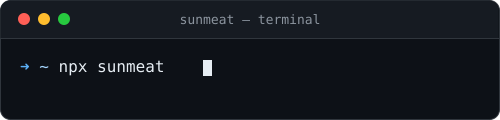

<p align="center">
  
</p>

<p align="center">
  <a href="https://github.com/sunmeat">
    
  </a>
</p>

<div align="center">


</div>

---


## 𝐇𝐞𝐥𝐥𝐨, 𝐟𝐞𝐥𝐥𝐨𝐰 <𝚌𝚘𝚍𝚎𝚛 />! 
<p align="left">
  <a href="https://www.linkedin.com/in/sunmeat/">
    
  </a>
  <a href="https://sunmeat.dev/">
    
  </a>
</p>

👇 Hit in your console or terminal to connect with me:
<p align="left">
  
</p>

[](https://www.npmjs.com/package/sunmeat)
[](https://www.npmjs.com/package/sunmeat)

<br>

```yaml
nickname: sunmeat
role: Software Engineer & Lecturer
focus: Full-Stack, Mobile & Systems Development
experience:
  - 19+ years teaching software engineering
  - 20+ contact hours/week
  - Production development on the side

languages:
  - C++        → performance-critical & systems programming
  - C#         → .NET ecosystem & enterprise solutions
  - Python     → automation, backend & data pipelines
  - Java       → enterprise systems & Android
  - JS / TS    → type-safe fullstack web development
  - Kotlin     → modern native Android
  - SQL        → data modeling & query optimization
  - PHP        → server-side web systems

skills:
  mobile:
    - Kotlin / Jetpack Compose
    - Material Design 3
    - Clean Architecture
    - MVI / MVVM
    - Coroutines / Flow
    - Room / DataStore
    - Navigation Compose
    - WorkManager
    - CameraX / ML Kit
    - Firebase (Auth, Firestore, Crashlytics)
    - Play Store deployment & release management
    - .Net MAUI

  backend:
    - ASP.NET Core / Node.js
    - Spring Boot / Django / FastAPI
    - EF Core / Dapper
    - RESTful API design & versioning
    - Authentication & Authorization (JWT, OAuth2)
    - Message queues (RabbitMQ / Kafka)
    - Caching strategies (Redis)
    - Background jobs & schedulers
    - Logging & structured error handling
    - API documentation (Swagger / OpenAPI)

  frontend:
    - React / Angular / Blazor
    - Electron.js
    - SPA & SSR architecture
    - State management (Redux / Zustand / Context API)
    - Component-driven development
    - Responsive & accessible UI (WCAG basics)
    - REST/GraphQL API integration
    - Build tooling (Vite / Webpack)
    - TypeScript-first development

  databases:
    - PostgreSQL / SQL Server / Oracle
    - MongoDB / Firebase / Redis
    - SQLite / Room
    - Database design & normalization
    - Query optimization & indexing
    - Migrations (EF Core Migrations)
    - Transactions & data consistency

  quality:
    - Unit / Integration testing (xUnit, JUnit, pytest)
    - TDD practices
    - Code review culture

  infrastructure:
    - Docker / CI/CD (GitHub Actions)
    - Cloud deployment (Azure / AWS / Render / Vercel / Netlify)
    - Monitoring & observability (logging, health checks)
    - Environment configuration & secrets management
    - Version control workflows (Git branching strategies)

  ai_ecosystem:
    - LLM API integration (Anthropic, OpenAI)
    - Prompt engineering
    - RAG-based assistants

highlights:
  - Designed and taught 30+ courses across C++, C#, Java, Python & web development,
from first-year fundamentals to industry-ready practice
  - Mentored 1000+ students over 19 years; multiple graduates now working at product companies
  - Built and maintained a full curriculum pipeline - lecture materials, labs, grading automation,
and internal tooling for course management
  - Balanced a ~20-classes/week teaching load with active hands-on development -
kept technical skills current across mobile, web & backend
  - Regularly updated course content to track industry shifts
(e.g. migrating curriculum from Java-only Android to Kotlin & Jetpack Compose)

```

<br clear="right"/>

---

## 🚀 Tech Stack

<h3 align="left">Languages</h3>
<p align="left">
  
</p>
<h3 align="left">Frameworks & Libraries</h3>
<p align="left">
  
</p>
<h3 align="left">Tools & Platforms</h3>
<p align="left">
  
</p>

---

## 🎹 A Little More About Me


<br/>

<p align="center">
When I'm not writing code or teaching, you'll find me:<br/><br/>
🌿 <b>Gardening</b> — tending plants with the same patience I apply to debugging<br/>
🪙 <b>Coin Collecting</b> — history in the palm of your hand<br/>
🎲 <b>Board Games</b> — strategy on the table, not just in code<br/>
🎨 <b>Acrylic Painting</b> — creative chaos, proudly committed<br/>
🎤 <b>Karaoke</b> — because syntax errors don't exist in song<br/>
🎵 <b>Music</b> — accordion · piano · melodica · sopilka · flute · drymba · kalimba · ukulele · guitar
</p>

<br/>

<p align="center">
  <a href="https://www.duolingo.com/profile/taemnus">
    
  </a>
</p>

<p align="center">
  <a href="https://duome.eu/taemnus">
    
  </a>
</p>

<br/>

---

## 💻 Weekly Coding Activity

<!--START_SECTION:waka-->


**I'm an Early 🐤** 

```text
🌞 Morning                3838 commits        ███░░░░░░░░░░░░░░░░░░░░░░   11.55 % 
🌆 Daytime                23443 commits       ██████████████████░░░░░░░   70.54 % 
🌃 Evening                5822 commits        ████░░░░░░░░░░░░░░░░░░░░░   17.52 % 
🌙 Night                  132 commits         ░░░░░░░░░░░░░░░░░░░░░░░░░   00.40 % 
```
📅 **I'm Most Productive on Thursday** 

```text
Monday                   3520 commits        ███░░░░░░░░░░░░░░░░░░░░░░   10.59 % 
Tuesday                  3660 commits        ███░░░░░░░░░░░░░░░░░░░░░░   11.01 % 
Wednesday                6201 commits        █████░░░░░░░░░░░░░░░░░░░░   18.66 % 
Thursday                 8534 commits        ██████░░░░░░░░░░░░░░░░░░░   25.68 % 
Friday                   3763 commits        ███░░░░░░░░░░░░░░░░░░░░░░   11.32 % 
Saturday                 6679 commits        █████░░░░░░░░░░░░░░░░░░░░   20.10 % 
Sunday                   878 commits         █░░░░░░░░░░░░░░░░░░░░░░░░   02.64 % 
```


📊 **This Week I Spent My Time On** 

```text
💬 Programming Languages: 
Python                   6 hrs 55 mins       ██████████████░░░░░░░░░░░   57.93 % 
Markdown                 1 hr 24 mins        ███░░░░░░░░░░░░░░░░░░░░░░   11.80 % 
HTML                     1 hr 7 mins         ██░░░░░░░░░░░░░░░░░░░░░░░   09.36 % 
TypeScript               1 hr 5 mins         ██░░░░░░░░░░░░░░░░░░░░░░░   09.15 % 
JavaScript               42 mins             █░░░░░░░░░░░░░░░░░░░░░░░░   05.96 % 

🔥 Editors: 
PyCharm                  7 hrs 44 mins       ████████████████░░░░░░░░░   64.66 % 
WebStorm                 4 hrs 13 mins       █████████░░░░░░░░░░░░░░░░   35.34 % 
```


 Last Updated on 01/11/2026 20:17:56 UTC
<!--END_SECTION:waka-->

### 🧬 Languages Across My GitHub Repositories

<!--START_SECTION:repo-languages-->
**Top 10 languages across all my GitHub repositories**

| # | Language | Share of code | Distribution | Repositories | Detected size |
|--:|:--|--:|:--|--:|--:|
| 1 | Rich Text Format | **46.51%** | █████████░░░░░░░░░░░ | 1 | 14.55 MiB |
| 2 | Python | **11.90%** | ██░░░░░░░░░░░░░░░░░░ | 35 | 3.72 MiB |
| 3 | JavaScript | **10.78%** | ██░░░░░░░░░░░░░░░░░░ | 103 | 3.37 MiB |
| 4 | TypeScript | **7.59%** | ██░░░░░░░░░░░░░░░░░░ | 15 | 2.38 MiB |
| 5 | C++ | **6.51%** | █░░░░░░░░░░░░░░░░░░░ | 49 | 2.04 MiB |
| 6 | CSS | **5.29%** | █░░░░░░░░░░░░░░░░░░░ | 120 | 1.65 MiB |
| 7 | C# | **5.17%** | █░░░░░░░░░░░░░░░░░░░ | 87 | 1.62 MiB |
| 8 | HTML | **4.04%** | █░░░░░░░░░░░░░░░░░░░ | 133 | 1.26 MiB |
| 9 | Java | **1.57%** | ░░░░░░░░░░░░░░░░░░░░ | 20 | 503.55 KiB |
| 10 | C | **0.38%** | ░░░░░░░░░░░░░░░░░░░░ | 4 | 121.62 KiB |

**Languages found:** 18 · **Repositories scanned:** 249 (237 with language data, 19 accessible private, 6 forks) · **Detected code:** 31.28 MiB.
**Other 8 languages:** 0.26% of detected code.

**Last successful refresh:** 07 Nov 2026, 10:20:39 UTC · 07 Nov 2026, 12:20:39 EET (Kyiv)

<sub>Data: GitHub Linguist /languages API. Percentages use detected file bytes across all languages (not only the top ten), not repository counts, lines written, or time spent. All accessible owned repositories are included, including forks and archived repos. Private repos require a permitted token; only aggregate statistics are exposed. GitHub Linguist can exclude generated and vendor code. Scheduled hourly.</sub>
<!--END_SECTION:repo-languages-->
---

## 🤖 AI Coding & GitHub Activity

<!--START_SECTION:codex-github-->
**02 Nov – 07 Nov 2026 (UTC)** · Week to date (from Monday)

| AI agent / activity | PRs | Commits in linked PRs | Marked default-branch commits | Lines added (PRs) | Lines removed (PRs) |
|:--|--:|--:|--:|--:|--:|
| 🤖 OpenAI Codex | **0** | 0 | 0 | +0 | −0 |
| 🟠 Claude Code | **0** | 0 | 6 | +0 | −0 |
| 🟣 GitHub Copilot | **0** | 0 | 0 | +0 | −0 |
| 🔵 Cursor | **0** | 0 | 0 | +0 | −0 |
| 💎 Gemini | **0** | 0 | 0 | +0 | −0 |
| 📦 All accessible PR activity | **52** | 463 | — | +36,849 | −2,274 |

Recently active repos scanned: **9** · With new PRs: **1** · With AI-marked PRs: **0** · Default-branch commit scans: **8**.

**Last successful data refresh:** 07 Nov 2026, 09:55:16 UTC · 07 Nov 2026, 11:55:16 EET (Kyiv)

<sub>Only PRs opened this week in repositories accessible to the token are counted. AI attribution is conservative: explicit bot/branch/label/PR metadata or commit author, Co-Authored-By and AI-Tool trailers. The PR columns show whole PR totals, not uniquely AI-authored lines. A PR can appear in more than one AI row, and default-branch commits can also be in PRs; columns must not be added together. Default-branch commits use the week's commit timestamps; the auto-updating profile repository is excluded from this separate scan. Local IDE/chat assistance without Git markers cannot be detected, including ordinary claude.ai chats. Use PR labels codex / claude-code / copilot / cursor / gemini, or an AI-Tool: Claude Code (etc.) commit trailer, for reliable attribution. No models, tokens or session time are inferred. Private repository names and content are not displayed.</sub>
<!--END_SECTION:codex-github-->

## 📊 GitHub Stats

<p align="center">
  
</p>

---

## 📈 Full Metrics

<p align="center">
  
</p>

---

## 📡 Activity Graph

<p align="center">
  
</p>

---

<p align="center">
  <picture>
    <source media="(prefers-color-scheme: dark)" 
            srcset="https://raw.githubusercontent.com/sunmeat/sunmeat/snake-output/github-contribution-grid-snake-dark.svg">
    <source media="(prefers-color-scheme: light)" 
            srcset="https://raw.githubusercontent.com/sunmeat/sunmeat/snake-output/github-contribution-grid-snake.svg">
    
  </picture>
</p>

<p align="center">
  <picture>
    <source media="(prefers-color-scheme: dark)" 
            srcset="https://raw.githubusercontent.com/sunmeat/sunmeat/pacman-output/pacman-contribution-graph-dark.svg">
    <source media="(prefers-color-scheme: light)" 
            srcset="https://raw.githubusercontent.com/sunmeat/sunmeat/pacman-output/pacman-contribution-graph.svg">
    
  </picture>
</p>

<p align="center">
  
</p>
<p align="center">
  <sub>🌍 Top visitor countries (flags) — updates in real-time</sub>
</p>

<p align="center">
  
</p>

<p align="center">
  <i>"The best error message is the one that never shows up."</i><br/>
  <sub>— Thomas Fuchs (and every lecturer ever)</sub>
</p>
